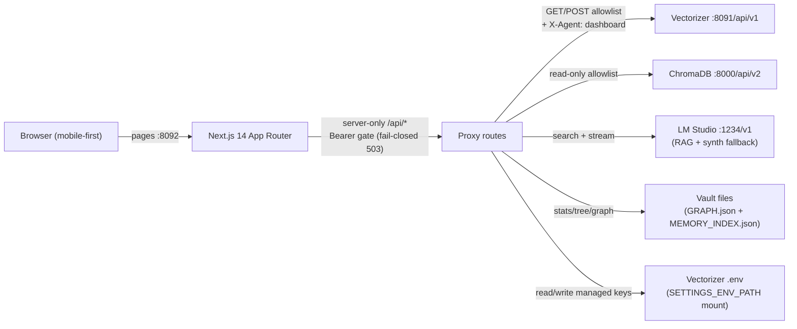

# Vectorizer Dashboard

[](https://github.com/alfirus/vectorizer-dashboard/actions/workflows/ci.yml)
[](https://github.com/alfirus/vectorizer-dashboard/tags)
[](LICENSE)
[](https://github.com/alfirus/vectorizer)

Next.js 14 + Tailwind — ops UI for [Vectorizer](../vectorizer) (semantic memory) + ChromaDB + Vault. Server-only secrets, mobile-first, Tailscale-ready.

## Live

- **Local:** `http://localhost:8092`
- **Tailscale:** `https://<tailnet-host>.ts.net/dashboard`
- **Production:** `https://<prod-host>` (Cloudflare proxied, HTTP basic auth)

## Features

- **Overview** — Health (`8091/health` + Chroma `heartbeat`), vault stats (68 files/1201 chunks/1419 nodes), workspace proportions, recent vault activity
- **Workspaces** — `GET /workspaces` + per-collection `GET /collections/:id/count` → workspace document counts. Creates/deletes workspaces.
- **Vault explorer** — `GET /api/vault?action=stats|files|tree|graph` → `MEMORY_INDEX.json + GRAPH.json`. Dry-run diff, reindex trigger with **real-time SSE progress bar**.
- **Semantic search** — `POST /messages/search` with workspace filter + `where.hybrid=true` toggle, highlight + copy per hit, latency sparkline. Note: `/messages/search/all` (no workspace filter) now fuses vector + BM25 server-side by default — `Semantic` mode there still returns hybrid-fused results; the toggle matters for single-workspace search (pure vector vs fusion). Per-hit `source` shows `hybrid` vs `semantic-fallback`.
- **Ask RAG** — `POST /api/brain` → single-workspace Vectorizer search (floored, merged) → LM Studio `<llm-model>` streaming; strips `<think>`, **abstains when nothing passes the relevance floor** instead of confabulating, falls back to synth answer from context when LM cold (no regex name-injection — that class of bug is dead). Sources collapsible with copy.
- **Embeddings** — `GET /collections` + `GET .../collections/:id/get` with `include=embeddings,documents,metadatas`. Dimension + sample vectors.
- **Knowledge graph** — `GRAPH.json` nodes/edges → `recharts` force-ish + BFS neighbors; stats 1419/7479.
- **Provenance + code pages** — `/dashboard/trace` (reasoning-chain timeline, forward/reverse), `/dashboard/stale` (dead-knowledge proposals with per-item forget), `/dashboard/code` (who-calls-X with click-through chaining) — all via the generic `app/api/vectorizer/[...path]` proxy, no backend changes needed.
- **Analytics** — `GET /messages/analytics` + workspace doc distribution + query latency bars.
- **Settings** — Desired-state schedules for the ubuntu-crontab jobs (`vectorizer-backup-daily`, `vectorizer-health-1h` — the real scheduler is host crontab, see Cron) + **Telegram** alerts + **Email SMTP** + **Backup retention**. Reads/writes the Vectorizer `.env` server-side (`SETTINGS_ENV_PATH`; writes need a vectorizer recreate), secrets masked in UI.

## Pages

| Route | What | Key details |
|-------|------|-------------|
| `/dashboard` | Overview | Health, vault stats, workspace proportions |
| `/dashboard/activity` | Activity | Usage, writeback queue, per-action mix |
| `/dashboard/workspaces` | Workspaces | Document counts, create/delete |
| `/dashboard/vault` | Vault explorer | File grid, dry-run, reindex with SSE progress bar |
| `/dashboard/search` | Semantic search | Workspace filter, hybrid toggle (matters for single-workspace; search-all fuses server-side by default), highlight + copy |
| `/dashboard/rag` | Ask RAG | Streaming LLM, source citations |
| `/dashboard/embeddings` | Embeddings | Dimension + sample vectors |
| `/dashboard/graph` | Knowledge graph | Force graph, BFS neighbors |
| `/dashboard/trace` | Trace | Reasoning-chain timeline, forward/reverse |
| `/dashboard/stale` | Stale | Dead-knowledge proposals with per-item forget |
| `/dashboard/code` | Code | Who-calls-X chaining |
| `/dashboard/analytics` | Analytics | Latency bars, doc distribution |
| `/dashboard/settings` | Settings | Cron desired-state, Telegram, SMTP, retention |

(Sidebar order — `components/Sidebar.tsx` is the source of truth; all 13 ship in the drawer + bottom tabs.)

## Stack & Ports

- **Next.js 14** (App Router), Tailwind `bg-background #0a0a0f / card #12121a / primary #7c3aed`, `Inter + JetBrains Mono`, `lucide-react`, `recharts`
- **Proxies** (server-only keys): `app/api/vectorizer/[...path]` → `http://vectorizer:8091/api/v1/*` (+ `X-API-Key`), `app/api/chroma/[...path]` → Chroma `8000/api/v2/*`, `app/api/brain` → Vectorizer search + LM Studio, `app/api/vault|graph|settings|admin/reindex`
- **Ports:** Vectorizer `8091`, Chroma `8100` (local) / `8102` (server), LM Studio `1234`, Dashboard `8092`
- **Docker:** `vectorizer:8091` inside, `host.docker.internal:1234` for LM Studio

## Architecture



Secrets never reach the browser: every `/api/*` route reads tokens from
server `process.env` and forwards them. The dashboard holds no vectorizer
state of its own — it is a lens over the API above (contract:
`docs/adr/0001-dashboard-vectorizer-contract.md`).

## API in Action

Same bearer token for every call (`DASHBOARD_AUTH_TOKEN`); the UI uses
these exact routes:

```bash
export D=http://localhost:8092
export T="$DASHBOARD_AUTH_TOKEN"

# Vectorizer health through the proxy (adds X-Agent: dashboard server-side)
curl -s -H "Authorization: Bearer $T" $D/api/vectorizer/health | jq '{status, chromadb}'
# {"status":"ok","chromadb":"ok"}

# Search analytics (the dashboard chart source)
curl -s -H "Authorization: Bearer $T" $D/api/vectorizer/messages/analytics | jq .

# Effective settings (managed keys from the server .env, secrets masked)
curl -s -H "Authorization: Bearer $T" $D/api/settings | jq '{env, schedules}'
```

Without the token every `/api/*` answers `401` — and when the token is
unset server-side, `503` (fail-closed, never an open proxy).

## Quick Start

### Local Development

```bash
cd vectorizer-dashboard
npm install
npm run dev
# Open http://localhost:3000
```

### Docker (with Vectorizer stack)

```bash
cd vectorizer
docker compose up -d
# Dashboard at http://localhost:8092
```

### Server Deployment

The dashboard ships as a sibling checkout next to the vectorizer repo (the
server compose file builds it via `build: ../vectorizer-dashboard`):

```bash
# Clone on server, next to the vectorizer checkout
git clone https://github.com/alfirus/vectorizer-dashboard.git <server-app-dir>-dashboard
cd <server-app-dir>-dashboard
```

**Do NOT use `.env.local` for Docker deploys.** It is excluded from the image
(`.dockerignore`) and no compose file mounts it — anything set there never
reaches the container. The canonical path is the Vectorizer private `.env`
(`<server-app-dir>/.env`), which the server compose file reads at create time:

```bash
# Set in <server-app-dir>/.env (private, never commit):
DASHBOARD_AUTH_TOKEN=<token>   # required — the /api/* gate is fail-closed (503) without it
DEFAULT_API_KEY=<key>          # passed through as VECTORIZER_API_KEY
LM_STUDIO_URL=<lm-studio-base-url>
LM_STUDIO_API_KEY=<key>        # empty when LM Studio auth is off (tailnet-only)
LLM_MODEL=<llm-model>
GRAPH_PATH=<vault-graph-json>  # e.g. /data/ai/<workspace>/vault/00-index/GRAPH.json
VAULT_DATA_DIR=<host-vault-dir>
```

```bash
# Build and start
docker compose -f <server-app-dir>/docker-compose.server.yml up -d --build dashboard
```

**⚠️ Important:** After code changes, you must rebuild the container:

```bash
docker compose -f <server-app-dir>/docker-compose.server.yml up -d --build --force-recreate --no-deps dashboard
```

A simple `docker compose restart` does NOT pick up code changes — Next.js standalone bundles need rebuilding.

## Env (Dashboard)

Local dev reads `.env.local`; **Docker deploys MUST use compose `environment:`**
(the image never contains `.env.local` — see Server Deployment). Every route
appends `/api/v1` itself, so the base URL must NOT carry the suffix:

```
# .env.local (local dev ONLY — never reaches Docker)
VECTORIZER_URL=http://vectorizer:8091
VECTORIZER_API_KEY=<vectorizer-api-key>
CHROMA_URL=http://chromadb:8000
LM_STUDIO_URL=http://host.docker.internal:1234/v1
LM_STUDIO_KEY=
LLM_MODEL=<llm-model>
VAULT_ROOT=/data/ai
GRAPH_PATH=/data/ai/<workspace>/vault/00-index/GRAPH.json
# Alerts + retention (also editable in /dashboard/settings)
ALERT_TELEGRAM_BOT_TOKEN=
ALERT_TELEGRAM_CHAT_ID=
ALERT_EMAIL_TO=alerts@example.com
ALERT_EMAIL_FROM=vectorizer@example.com
SMTP_HOST=smtp.gmail.com
SMTP_PORT=587
SMTP_USER=
SMTP_PASS=
BACKUP_RETENTION_DAYS=7
```

Docker-only settings (compose `environment:`, see Compatibility + Docker settings below):

```
DASHBOARD_AUTH_TOKEN=<token>  # required — /api/* is fail-closed (503) without it
SETTINGS_ENV_PATH=/run/vectorizer-env/.env                 # vectorizer .env mount (read/write)
SETTINGS_SCHEDULES_PATH=/run/vectorizer-env/cron_schedules.json  # desired-state schedules
REINDEX_SCRIPT_DIR=/data/ai/<workspace>/vault/00-index     # override for the index scripts
REINDEX_PYTHON=python3
```

Never expose `ALERT_* / SMTP_* / API_KEY` client-side — read only via `process.env` in `app/api/*` route handlers.

## Compatibility (dashboard ↔ vectorizer)

The dashboard is not versioned against the vectorizer API by accident — pair them deliberately:

| Dashboard | Vectorizer API | Notes |
|-----------|----------------|-------|
| v0.1.0 | v0.4.0+ (`ae07294` and later) | First versioned pairing. Requires the fail-closed auth + `X-Agent` attribution contract. |

Contract the dashboard depends on (see `docs/adr/0001-dashboard-vectorizer-contract.md`):

- `VECTORIZER_URL` is the bare base (e.g. `http://vectorizer:8091`) — every
  route appends `/api/v1` itself. A URL already ending in `/api/v1` 404s everything.
- Auth: `X-API-Key` on every call; `X-Agent: dashboard` on every call
  (required when the backend runs with `REQUIRE_X_AGENT=true`).
- Response shapes: `/usage/daily`, `/messages/analytics`, Prometheus metric
  names (`vectorizer_writeback_*`). A vectorizer rename degrades the dashboard
  to silent zeros — there are no contract tests yet (P2).

## Docker settings (SETTINGS_ENV_PATH)

`GET /api/settings` reads the Vectorizer `.env`; `POST` writes the managed keys
(`ALERT_*`, `SMTP_*`, `BACKUP_RETENTION_DAYS`, schedules) back to it. In Docker
this works only through an explicit mount — the container has no vectorizer
checkout of its own:

- Compose mounts the live file: `./.env:/run/vectorizer-env/.env`, with
  `SETTINGS_ENV_PATH=/run/vectorizer-env/.env` (server compose; the file stays
  `600 ubuntu:ubuntu` — the service runs as that UID, see `user: "1000:1000"`
  in `docker-compose.server.yml`). Unset `SETTINGS_ENV_PATH` → reads return
  `{}`, writes return `501`.
- Schedules live beside it: `SETTINGS_SCHEDULES_PATH=/run/vectorizer-env/cron_schedules.json`
  (desired state only — see Cron).
- **Writes need a vectorizer recreate to take effect**: the vectorizer reads its
  `.env` once at container create time (`env_file`), so after `Save` run
  `./up.sh recreate vectorizer` (healthcheck scripts pick up `ALERT_*/SMTP_*`
  on their next run without a recreate).
- Reindex scripts: `REINDEX_SCRIPT_DIR` overrides the script lookup
  (`<workspace>/vault/00-index/` under `VAULT_ROOT` + fallbacks). Set it in the
  private `.env` when the index scripts live elsewhere.

## Vault Writeback (staging mirror)

When the engine has `VAULT_WRITEBACK=true`, every stored turn is mirrored to per-session staging markdown (`<agent>/vault/10-memory/sessions/<session>.md`, frontmatter `generated_by: vectorizer`, `status: staging`). The dashboard surfaces it two ways:

- **Activity → Vault Writeback** cards: `vectorizer_writeback_writes_total` (appends), `vectorizer_writeback_drops_total` (queue-full loss), `vectorizer_writeback_skipped_ro_total` (vault read-only), `vectorizer_writeback_queue_depth`. All four parse from `/metrics` in `lib/api.ts:parseMetrics`.
- **Vault → Staging sessions / Inbox candidates** filter chips: shortcut the file list to `sessions/` (writeback output) and `00-inbox/` (promotion candidates). Staging files are `status: staging` — promotion to curated truth stays manual.

## Cron (host)

Single canonical owner: **ubuntu's crontab on the host**, installed by
`vectorizer`'s `ops-cron/install.sh` (verified live — see that repo's
`ops-cron/README.md`). Hermes cron does not run vectorizer jobs, there is no
reindex cron job, and the root-level `vectorizer_*.py` scripts are stale
Windows-local files — not scheduler input:

```
vectorizer-backup-daily 0 3 * * *    (nightly Chroma volume + sqlite snapshot + config bundle, 7d retention)
vectorizer-health-1h    0 * * * *    (hourly stack probe + backup freshness watchdog, alerts on fail)
```

`vectorizer-health-1h.sh` reads `ALERT_* + SMTP_*` from the Vectorizer `.env`
for alerts. `Settings → Save` persists **desired state** to
`cron_schedules.json` (`SETTINGS_SCHEDULES_PATH`) — it does not edit crontab;
change real schedules via SSH on the host.

## Vault Reindex (SSE Progress Bar)

The vault page features a real-time progress bar powered by Server-Sent Events:

**Backend** (`app/api/admin/reindex/route.ts`):
- Spawns `python3 vault_index.py` with `spawn()` (not `execFile`)
- Streams stdout line-by-line via `ReadableStream`
- Parses progress from script output:
  - `found N markdown files` → total file count
  - `[workspace file imp=N] path hash=... chunks=N` → per-file progress (dry-run)
  - `indexed path: +N chunks` → per-file progress (actual indexing)
  - `Done: indexed N files, M chunks` → completion
- Sends SSE events: `phase`, `log`, `progress`, `vault_done`, `done`, `error`

**Frontend** (`app/dashboard/vault/page.tsx`):
- Uses `fetch()` + `ReadableStream` reader (not `EventSource` — needed for POST)
- Animated gradient progress bar (`bg-gradient-to-r from-emerald-500 to-cyan-500`)
- Status text, file count, chunk count, percentage
- "Done" button on completion
- Expandable log viewer for raw output

**API:**
```bash
# Dry run (preview)
POST /api/admin/reindex?workspace=<workspace>
Accept: text/event-stream
Content-Type: application/json
{"dryRun": true}

# Actual reindex
POST /api/admin/reindex?workspace=<workspace>
Accept: text/event-stream
Content-Type: application/json
{"dryRun": false}

# Options
{"dryRun": false, "limit": 10}       # index max 10 files
{"dryRun": false, "reindex": true}   # force reindex all (ignore hash cache)
{"dryRun": false, "workspace": "<workspace>"}  # filter by workspace
```

## Security

- `next.config.js` `output: standalone` + headers: `X-Frame-Options DENY, X-Content-Type-Options nosniff, Cache-Control no-store` on `/api/*` (no `Content-Security-Policy` header — clickjacking is handled by `X-Frame-Options`, API abuse by the bearer gate + rate limit)
- Bearer-token gate (`DASHBOARD_AUTH_TOKEN`) on every `/api/*` route via `middleware.ts` + in-code re-checks on privileged handlers; fail-closed (503) when the token is unset
- CORS via Vectorizer `CORS_ALLOWED_ORIGINS=*` (Tailscale/mobile)
- Rate limit per-IP token bucket in the middleware: 120 req/min default, 20 req/min for `/api/admin/*` + `/api/brain`
- **HTTP basic auth** on production (`<prod-host>`)
- All secrets server-side only — never exposed to browser

## Mobile

- `app/layout.tsx` `viewport: device-width`
- `Shell` = `flex-col` on mobile (header `56px` full-bleed) + `lg:flex-row` (sidebar `240px`)
- `Sidebar` = top bar + 5-item bottom tabs (`safe-bottom`) + drawer `300px slideIn` with all 13 pages (Overview, Activity, Workspaces, Vault, Search, RAG, Embeddings, Graph, Trace, Stale, Code, Analytics, Settings)
- `globals.css` `input min-h 44px, button min-h 44px, font 16px` to avoid iOS zoom
- `StatCard` + pages use `rounded-2xl shadow-card` + `grid-cols-1 lg:grid-cols-2` responsive

## Structure

```
vectorizer-dashboard/
├── app/
│   ├── api/
│   │   ├── brain/route.ts              # RAG: search + LM Studio streaming + synth fallback
│   │   ├── chroma/[...path]/route.ts   # Chroma proxy (read-only allowlist)
│   │   ├── vectorizer/[...path]/route.ts # Vectorizer proxy (allowlisted paths, X-Agent: dashboard)
│   │   ├── vault/route.ts              # Stats/files/tree/graph from /data/ai
│   │   ├── graph/route.ts              # Graph data from GRAPH.json
│   │   ├── activity/route.ts           # Usage + metrics rollup
│   │   ├── usage/route.ts              # Daily usage passthrough
│   │   ├── usage-by-agent/route.ts     # Per-agent usage rollup
│   │   ├── admin/reindex/route.ts      # SSE streaming vault reindex
│   │   └── settings/route.ts           # Reads/writes Vectorizer .env + cron_schedules.json
│   ├── dashboard/
│   │   ├── page.tsx                    # Overview
│   │   ├── workspaces/page.tsx         # Counts via /count per collection
│   │   ├── vault/page.tsx                # Card grid + reindex progress bar
│   │   ├── search/page.tsx               # Highlight + measure sparkline
│   │   ├── rag/page.tsx                  # 100dvh streaming + quick prompts
│   │   ├── embeddings/page.tsx
│   │   ├── graph/page.tsx
│   │   ├── analytics/page.tsx
│   │   ├── activity/page.tsx             # Usage + writeback + per-action mix
│   │   ├── trace/page.tsx                # Reasoning-chain timeline
│   │   ├── stale/page.tsx                # Dead-knowledge proposals
│   │   ├── code/page.tsx                 # Who-calls-X chaining
│   │   └── settings/page.tsx           # Cron + Telegram + SMTP + retention
│   ├── layout.tsx                      # Viewport device-width, Inter
│   └── globals.css                     # 44px taps, 16px ios
├── components/Sidebar.tsx              # Top bar + bottom tabs + drawer
├── components/Shell.tsx                # flex-col mobile, flex-row desktop
├── components/StatCard.tsx
├── lib/api.ts                          # PROXY /api/vectorizer, CHROMA_PROXY /api/chroma
├── lib/types.ts
├── Dockerfile                          # Multi-stage: deps → builder → runner (Alpine + python3)
└── .env.local                          # Server-only secrets
```

## License

MIT — see [LICENSE](LICENSE).
